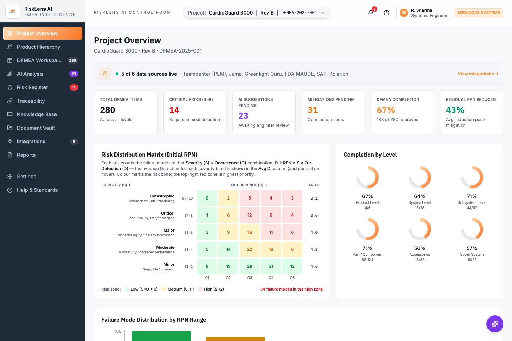
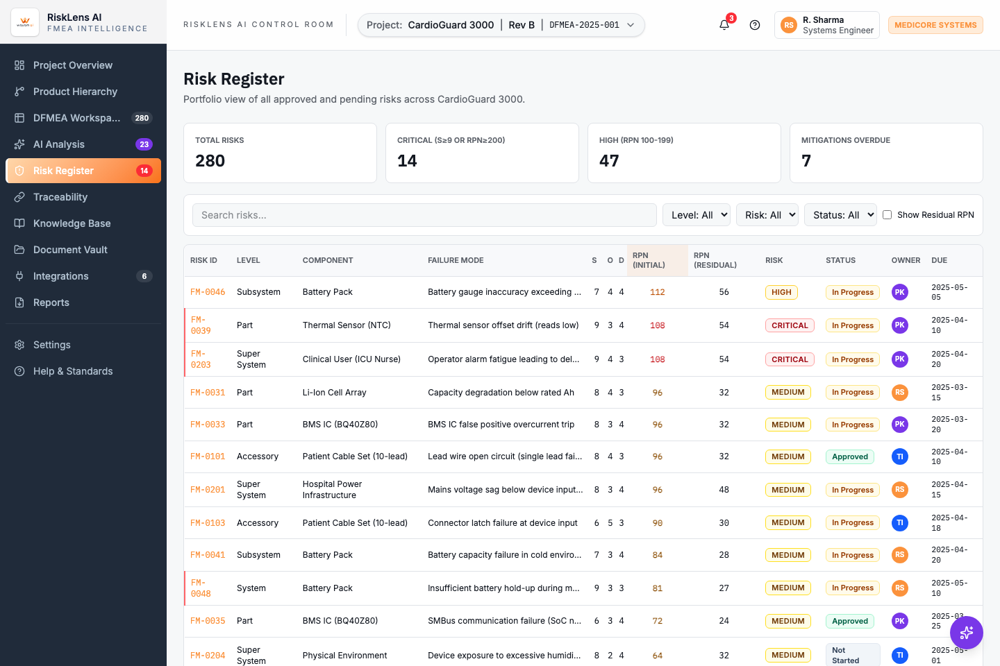

# PragnaAI — FMEA Intelligence

An AI-assisted DFMEA (Design Failure Mode and Effects Analysis) platform for medical device risk analysis, built by Wayam AI. Tracks failure modes, risk scoring (RPN), mitigations, traceability, and AI-generated suggestions across a product hierarchy.

**Live demo (Vercel, full SSR app):** **https://pragnaai.vercel.app/**

**Live demo (GitHub Pages, static SPA build):** **https://arkabera2004.github.io/FMEA/**

## Screenshots

### Project Overview


### Risk Register


## What's inside

- **Project Overview** — control-room dashboard: DFMEA item counts, critical risks, AI suggestions pending, mitigation status, completion by product level, risk distribution matrix.
- **Product Hierarchy** — navigate the device tree (product → system → subsystem → part) with per-node DFMEA status.
- **DFMEA Workspace** — the failure-mode-by-failure-mode working table (Severity/Occurrence/Detection, RPN).
- **AI Analysis** — review AI-generated failure-mode suggestions (accept/edit/reject).
- **Risk Register** — sortable register of all identified risks, initial vs. residual RPN.
- **Traceability** — matrix/chain views linking requirements → functions → failure modes → tests.
- **Knowledge Base**, **Document Vault**, **Integrations**, **Reports** — supporting workflows.

Data in this build is static mock data (`src/data/`) for demo purposes — there is no backend.

## Tech stack

- [TanStack Start](https://tanstack.com/start) (React + TanStack Router) with Vite
- Tailwind CSS v4 + shadcn/ui component library
- Recharts for charts

## Prerequisites

- Node.js 20+ (recommended: 20 or 22)
- npm 10+

Check versions:

```bash
node -v
npm -v
```

## 1. Install dependencies

From project root:

```bash
npm install
```

## 2. Run in development mode

```bash
npm run dev
```

Open the local URL shown in terminal (usually http://localhost:5173).

## 3. Build for production (SSR)

```bash
npm run build
```

This is the full TanStack Start SSR build (Nitro, `cloudflare-module` preset by default) — the same one used for `npm run dev`/`npm run preview`.

## 4. Preview production build

```bash
npm run preview
```

## Deploying to Vercel

Vercel runs the real SSR app (no workaround needed) — `vite.config.ts` auto-selects Nitro's `vercel` preset whenever the `VERCEL` env var is present (Vercel sets this during its own build), otherwise it defaults to `cloudflare-module`. Deploy with the Vercel CLI:

```bash
vercel --prod
```

Live at: **https://pragnaai.vercel.app/**

## Deploying to GitHub Pages

GitHub Pages only serves static files, so this repo has a **separate, isolated build path** for it (`vite.gh-pages.config.ts` + `src/entry-spa.tsx`) that renders the same app as a plain client-side SPA instead of using the SSR/Nitro pipeline above. It does not affect `npm run dev`/`npm run build` at all.

```bash
npm run build:gh-pages
```

Output goes to `dist-gh-pages/`. The GitHub Actions workflow at `.github/workflows/gh-pages.yml` runs this automatically on every push to `main` and deploys it via GitHub Pages — see the live demo link above.

## Useful scripts

- Dev server: `npm run dev`
- Production build (SSR): `npm run build`
- Development build: `npm run build:dev`
- Static SPA build (GitHub Pages): `npm run build:gh-pages`
- Lint: `npm run lint`
- Format: `npm run format`

## Troubleshooting

- If dependencies are broken:

```bash
rm -rf node_modules package-lock.json
npm install
```

- If port is in use, stop old process and rerun `npm run dev`.

- To check code issues:

```bash
npm run lint
```
